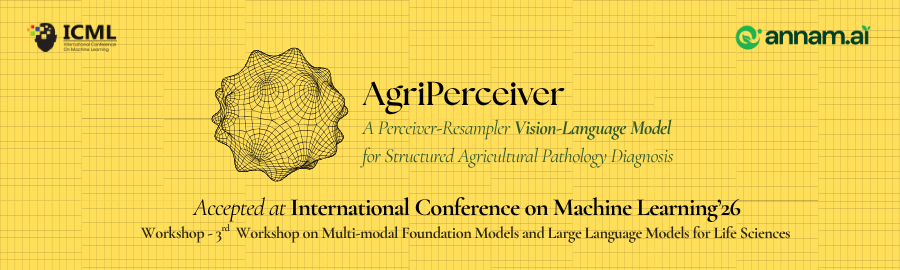

<div align="center">



# AgriPerceiver

### A Parameter-Efficient Vision-Language Model for Structured Macroscopic Crop Phenotyping

*ICML 2026 FM4LS Workshop &nbsp;·&nbsp; ICA 2026 (Springer CCIS)*

<br/>

[](https://icml.cc/virtual/2026/72095)
[](#)
[](https://icml2026fm4ls.github.io/index.html)
[](https://icml.cc/)
[](https://ica26.annam.ai/)
[](#)
[](#)
[](LICENSE)
[](https://www.python.org/)

<br/>

**[Vatsal Khanna](https://github.com/VatsalKhanna5)**  &nbsp;&amp;&nbsp;  **[Davinder Singh](https://github.com/Davinder1436)**

[**ICA 2026 paper (PDF)**](papers/ica26/main.pdf) &nbsp;·&nbsp; [**ICML FM4LS paper**](https://icml.cc/virtual/2026/72095) &nbsp;·&nbsp; [**Slides**](presentations/ica26/export/AgriPerceiver-ICA26.pdf) &nbsp;·&nbsp; [**Docs**](docs/README.md) &nbsp;·&nbsp; [**Citation**](#citation)

</div>

---

## News

- **[Nov 2026]** AgriPerceiver at **ICA 2026**, IIT Ropar (1–4 Nov). [Slides](presentations/ica26/export/AgriPerceiver-ICA26.pdf) and the [HTML deck](presentations/ica26/) are in this repo.
- **[Sep 2026]** ICA 2026 camera-ready (Springer CCIS) is out: [PDF](papers/ica26/main.pdf) and [source](papers/ica26/).
- **[Jul 2026]** Presented at the **ICML 2026 FM4LS Workshop** in Seoul.
- **Coming soon:** model weights and the 101K-sample dataset on HuggingFace.

---

## Overview

AgriPerceiver is a lightweight vision-language model that turns a single photograph of a plant leaf
into a **structured JSON diagnostic report** covering disease identity, pathology type, severity,
symptoms, reasoning and recommended actions.

Its core is a **perception bridge**. A Perceiver Resampler compresses 3,645 high-resolution visual
tokens into **128 latents** (a 28.5× reduction), while learned tile-position embeddings keep track
of where each patch came from. Both backbones stay frozen: the bridge is first aligned, then
specialised with LoRA on 101K reports labelled automatically by Gemma-3. Only **9.2%** of the
parameters are trained.

On a 5,062-sample test set AgriPerceiver reaches a **composite score of 0.810**, against
0.590–0.615 for 7–8B general-purpose VLMs. Pathology-type F1 improves **1.9×** over the strongest
baseline, and severity error falls from 0.224 to **0.067** MAE.

<details>
<summary><b>Method at a glance</b></summary>

```
Leaf image ─► AnyRes tiling ─► SigLIP-SO400M ─► + tile embeddings ─► MLP projector ─► Perceiver Resampler ─► Phi-3-mini ─► JSON report
              5 × 384²         5 × 729 × 1152     (spatial grounding)   1152 → 3072      3,645 → 128 latents    3.8B + LoRA
                               frozen                                                    2 blocks               frozen base
```

| Component | Parameters | Training |
|---|---|---|
| SigLIP-SO400M-patch14-384 | ~400M | Frozen |
| Perception bridge (tile embeddings + projector + Perceiver) | ~391M | Stages 1 and 2 |
| Phi-3-mini-128k-instruct | ~3.82B | Frozen; LoRA r=32 (~35M) in Stage 2 |

See [docs/ARCHITECTURE.md](docs/ARCHITECTURE.md) for details.
</details>

---

## Results

| Model | Params | Schema% | Type-F1 ↑ | Diag-FM ↑ | Sev-MAE ↓ | Sev-r ↑ | BERT-sym ↑ | **Composite ↑** |
|---|---|---|---|---|---|---|---|---|
| LLaVA-NeXT-7B | 7B | 99.9 | 0.134 | 0.001 | 0.344 | 0.226 | 0.847 | 0.590 |
| InternVL2-8B | 8B | 100.0 | 0.336 | 0.005 | 0.385 | 0.624 | 0.848 | 0.611 |
| Qwen2-VL-7B | 7B | 99.9 | 0.287 | 0.001 | 0.224 | 0.666 | 0.830 | 0.615 |
| **AgriPerceiver** | **4.6B** | 99.7 | **0.645** | **0.486** | **0.067** | **0.855** | **0.921** | **0.810** |

Results are on the 5,062-sample held-out test set. Baselines get the same structured prompt and are
not fine-tuned. The composite is a weighted sum of nine metrics. The per-class breakdown, ablations,
robustness checks and analysis are in [docs/RESULTS.md](docs/RESULTS.md), and the metric definitions
are in [docs/EVALUATION.md](docs/EVALUATION.md).

---

## Getting Started

```bash
git clone https://github.com/VatsalKhanna5/agri-perceiver.git
cd agri-perceiver
pip install -e ".[eval]"        # Python ≥ 3.10, PyTorch ≥ 2.1; see docs for other extras
```

```python
from agri_perceiver.inference.predictor import AgriPredictor

predictor = AgriPredictor("checkpoints/specialist_e3.pt")
report = predictor.predict("path/to/leaf.jpg")   # DiagnosticReport: diagnosis, type, severity, ...
```

```bash
agri-predict --image leaf.jpg --checkpoint checkpoints/specialist_e3.pt
```

| Task | Guide |
|---|---|
| Install, weights, inference and output schema | [docs/GETTING_STARTED.md](docs/GETTING_STARTED.md) |
| Train both stages | [docs/TRAINING.md](docs/TRAINING.md) |
| Batch inference, scoring, baselines and ablations | [docs/EVALUATION.md](docs/EVALUATION.md#running-evaluation) |
| Rebuild the training data | [docs/DATA_PIPELINE.md](docs/DATA_PIPELINE.md) |

### Model weights and data

| Artifact | Status |
|---|---|
| `agri-perceiver/specialist-e3` — Stage-2 model | [](#) |
| `agri-perceiver/stage1-bridge` — Stage-1 bridge | [](#) |
| `agri-perceiver/canonical-dataset` — 101K training samples | [](#) |

---

## Repository Structure

```
src/agri_perceiver/   model, data, training, inference (agri-predict), evaluation (agri-eval)
configs/              reference hyperparameters
data_pipeline/        Gemma-3 labelling pipeline
scripts/              experiments/ (inference, baselines, ablations) · paper/ (figures, checks)
jobs/                 PBS cluster jobs
results/              evaluation output
tests/                pytest suite
docs/                 documentation
papers/               ica26/ (camera-ready + PDF) · icml26-fm4ls/
presentations/        ica26/ talk deck
```

The annotated map is in [docs/README.md](docs/README.md#repository-map).

---

## Citation

If you find AgriPerceiver useful, please cite:

```bibtex
@inproceedings{khanna2026agriperceiver,
  title={AgriPerceiver: A Parameter-Efficient Vision-Language Model for Structured Macroscopic Crop Phenotyping},
  author={Khanna, Vatsal and Singh, Davinder},
  booktitle={ICML 2026 3rd Workshop on Multi-modal Foundation Models and Large Language Models for Life Sciences}
}

@inproceedings{khanna2026agriperceiverica,
  title={AgriPerceiver: A Parameter-Efficient Vision-Language Model for Structured Macroscopic Crop Phenotyping},
  author={Khanna, Vatsal and Saini, Samridhi and Singh, Davinder and Kwatra, Kumkum},
  booktitle={International Conference on Agriculture-Centric Computation (ICA 2026)},
  series={Communications in Computer and Information Science},
  publisher={Springer},
  year={2026}
}
```

Venue details and author lists for both papers are in [docs/PUBLICATIONS.md](docs/PUBLICATIONS.md).

---

## Acknowledgements

This work was carried out under the guidance of **Dr. Roshan Bodile** and **Dr. Rohit Singh** (Department of Electronics and Communication Engineering, Dr. B. R. Ambedkar National Institute of Technology Jalandhar), whose sustained mentorship shaped both the research direction and the technical rigor of this project.

Logistical support, domain expertise, and computational infrastructure were provided by **[Annam.ai](https://annam.ai)** — an AI Centre of Excellence in Agriculture established at the Indian Institute of Technology Ropar, under the leadership of **Dr. Pushpendra Pal Singh** (Project Director). The H200 GPU compute on which all training and evaluation runs were conducted was made available through Annam.ai. This work aims to contribute to the broader mission of Annam.ai in advancing AI-driven solutions for Indian and global agriculture.

---

## License

Released under the [Apache 2.0 License](LICENSE). The pre-trained backbones keep their own licenses:
[SigLIP-SO400M](https://huggingface.co/google/siglip-so400m-patch14-384) (Apache 2.0),
[Phi-3-mini-128k-instruct](https://huggingface.co/microsoft/Phi-3-mini-128k-instruct) (MIT), and
[Gemma-3-12B-IT](https://ai.google.dev/gemma/terms) (Gemma Terms of Use, data pipeline only).

<div align="center">
<br/>

*"The difficulty lies not so much in developing new ideas as in escaping from old ones."*
— John Maynard Keynes

</div>
